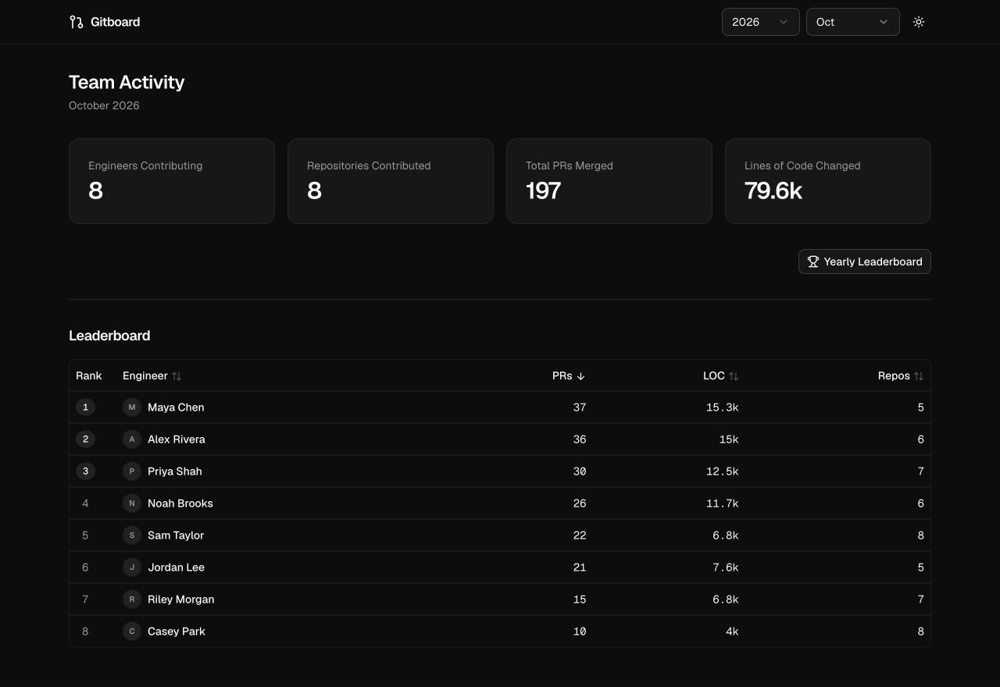
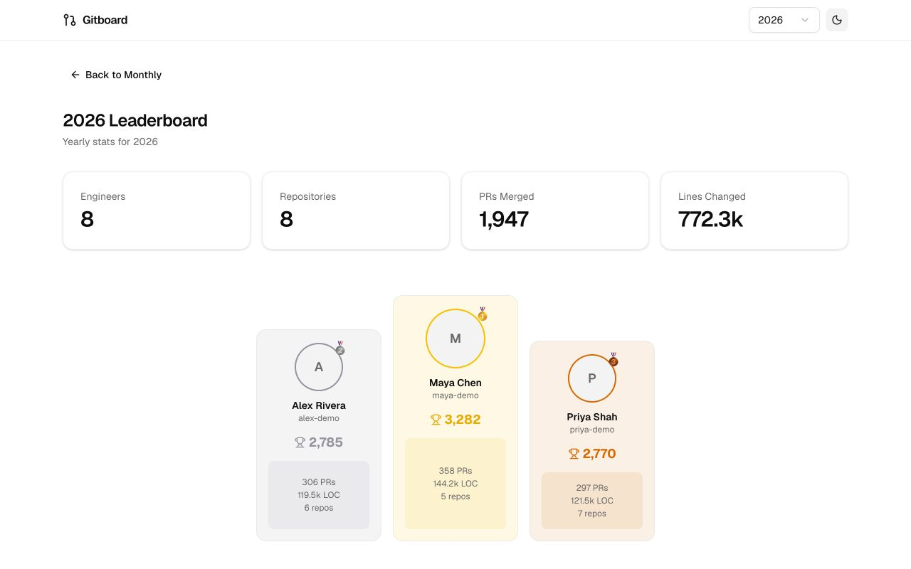
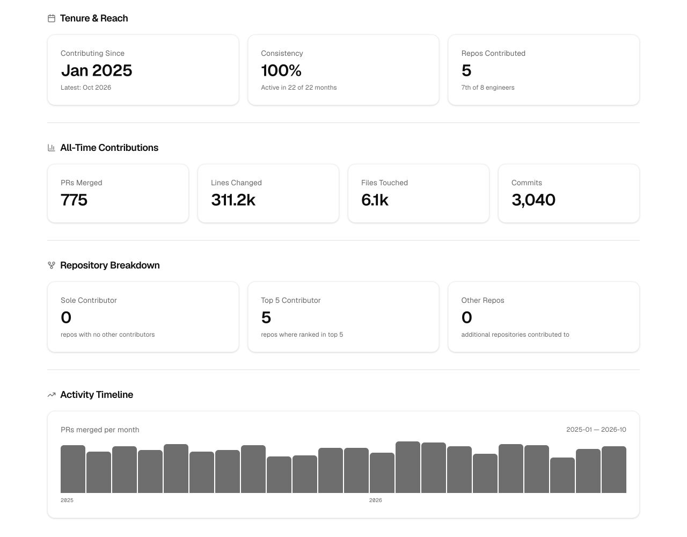

# User guide

Start with [Getting started](getting-started.md). The dashboard displays activity already imported into PostgreSQL; changing a date or reloading a page does not run a GitHub import.

## Monthly team activity

The home page shows the number of contributing engineers, repositories, merged pull requests and lines changed for the selected month. The year selector and month picker let you browse periods with imported activity.

Use the leaderboard column headers to sort by contributor, pull requests, lines changed or repository count. Open a contributor to see their monthly profile.



## Yearly leaderboard

Choose **Yearly Leaderboard** from the monthly dashboard. The yearly view shows totals, a top-three podium and a sortable table. The year selector changes the reporting period.

The default ranking uses the rounded composite score defined in [`computeScore`](../src/lib/queries.ts):

```text
score = round((PRs × 5) + (LOC ÷ 100) + (repos × 10))
```

Here, LOC means additions **plus** deletions, and repos means distinct repositories with merged contributions during the year. Sorting by another column changes the table ordering.

Activity counts and this formula describe selected GitHub events. They do not measure contribution quality, effort or a person's overall performance; interpret them alongside the underlying work and team context.



## Contributor profiles

Click a contributor in the monthly leaderboard or yearly podium to open their profile. The monthly page shows:

- GitHub profile details when imported
- Pull-request, line-change and repository totals with monthly ranks
- Weekly summaries when AI is configured and available
- A table of the underlying merged pull requests

The theme button switches between light and dark modes.

## Highlights

Choose **Highlights** from a contributor profile. This page shows all-time contribution history, active months, repository reach, total pull requests, line changes, files touched, commits and a monthly activity timeline.

The repository breakdown distinguishes sole-contributor repositories, repositories where the contributor ranks in the top five, and other repositories they contributed to.



All images on this page show fictional demo data. The Highlights image is a cropped detail; it excludes the optional AI banner.

## Optional AI

With `AI_API_KEY` configured on the web server, GitBoard can request weekly summaries and a profile narrative from Anthropic. The Highlights banner offers **Roast** and **Spotlight** tones.

Without a key, the AI endpoints return `503`. Metrics, tables and the activity timeline still work, while the current UI may display an unavailable-summary message or fallback banner text. Generated output is not written back to the database; banner results are cached in the client.

AI calls can incur provider charges and send contribution data to a cloud service. See [privacy and security](privacy-and-security.md#ai-data-flow) before enabling them.
